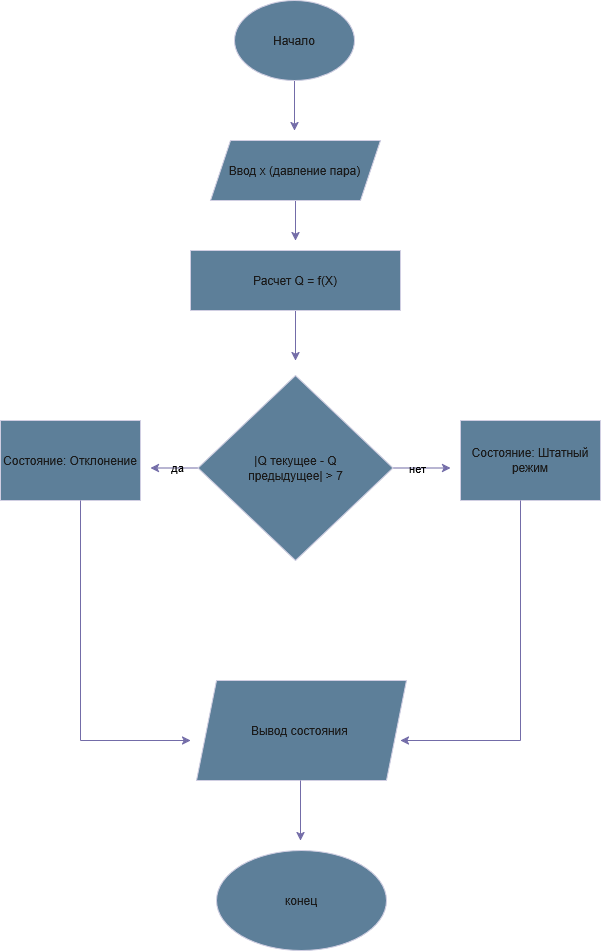
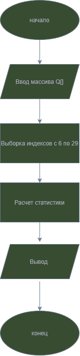

# Название проекта: Цифровой двойник технологического процесса (Вариант 21)

## Назначение
Мониторинг реактора: контроль давления пара, оперативное выявление отклонений и статистический анализ.

## Входные данные
*   **Параметр:** Давление пара (X)
*   **Единица измерения:** бар
*   **Диапазон X:** от 2 до 15
*   **Количество измерений (N):** 50
*   **Нормальное состояние:** штатный режим 5–10 бар. Значения вне диапазона — отклонение.

## Математическая модель (Преобразование показания)
Формула для расчета Q(X):

$$
Q(X) = 
\begin{cases} 
2 \cdot (X - 5) + 10, & \text{при } X < 5 \\
\frac{(X - 7.5)^2}{1} + 45, & \text{при } 5 \le X \le 10 \\
3 \cdot \sqrt{X - 10 + 1} + 55, & \text{при } X > 10 
\end{cases}
$$

## Ручной расчет (2-3 значения)
*   **X = 4:** (по первой формуле) Q = 2*(4-5)+10 = 2*(-1)+10 = 8.
*   **X = 5.00:** (по второй формуле, контрольный пример) Q = (5-7.5)^2 + 45 = (-2.5)^2 + 45 = 6.25 + 45 = 51.25.
*   **X = 12:** (по третьей формуле) Q = 3*sqrt(12-10+1) + 55 = 3*sqrt(3) + 55 ≈ 3*1.732 + 55 ≈ 60.196.
## Блок-схемы

### Схема 1: Поток данных

### Схема 2: Статистика
